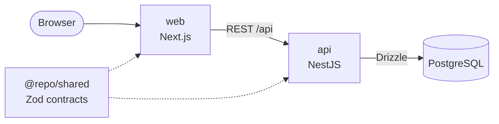

# Anwar Shah & Sons

An online store for Anwar Shah & Sons, my uncle's clothing business. It's built as one TypeScript
monorepo, with a Next.js storefront and a NestJS REST API.

> Infrastructure (AWS, provisioned with Terraform) lives in a [separate repository](https://github.com/hassanshah0900/anwar-shah-and-sons-infrastructure).

## Architecture



- **`web`**: Next.js (App Router) storefront. Server Components call the API from the server.
- **`api`**: NestJS REST API. Owns the database through Drizzle ORM.
- **`shared`**: Zod schemas and inferred types for every API contract, used by both
  apps. A breaking API change fails type checking in the web app.

## Tech stack

| Area      | Choice                               |
| --------- | ------------------------------------ |
| Language  | TypeScript (strict)                  |
| Frontend  | Next.js 16, React 19, Tailwind CSS 4 |
| UI        | shadcn/ui (Radix), Lucide icons      |
| Backend   | NestJS 12                            |
| Database  | PostgreSQL, Drizzle ORM              |
| Contracts | Zod 4                                |
| Auth      | Better Auth (sessions, roles)        |
| Testing   | Vitest, Supertest, Playwright        |
| Linting   | ESLint (web), oxlint (api), Prettier |
| Monorepo  | npm workspaces                       |

## Repository structure

```
web/                Next.js storefront
api/                NestJS API
shared/             API contracts (Zod schemas + types), used by web and api
e2e/                Playwright browser tests (run web + api together)
docs/adr/           architecture decision records
tsconfig.base.json  TypeScript settings every project extends
```

Each top-level project folder is an [npm workspace](https://docs.npmjs.com/cli/using-npm/workspaces)
with its own `package.json`. Run a script in one of them with `-w`, e.g. `npm run dev -w web`.

## Getting started

### Prerequisites

- Node.js 24 (`nvm use`)
- Docker (for the local PostgreSQL database)

### Setup

```bash
npm install

cp .env.example .env                          # choose a POSTGRES_PASSWORD
cp api/.env.example api/.env        # use the same password in DATABASE_URL
cp web/.env.example web/.env.local

docker compose up -d db                       # PostgreSQL on localhost:5432
npm run db:migrate -w api                     # apply database migrations
npm run db:seed -w api                        # create the admin from ADMIN_* in api/.env
npm run db:seed:demo -w api                   # optional: demo catalog, customers and orders
npm run dev
```

Sign in at http://localhost:3000/sign-in with the admin account to reach `/admin`, or
create a customer account at `/sign-up`.

The demo seed adds 18 products across Women, Men and Kids (with photos, sizes, colours and
stock), 8 customers (`*@demo.example.com`, password `demo-password`) with addresses, and 60
orders over the last two months. It only adds what's missing, and refuses to run with
`NODE_ENV=production`. Run it again after pulling to pick up new demo data: products from an
older run get their photos in place of the earlier drawn images. The photos are from Pexels
(see `api/seed/demo/photos/README.md`).

The local database is PostgreSQL 17 in Docker. The password is passed to the container as
a Compose secret, not an environment variable. Stop it with `docker compose down`; add `-v`
to delete its data. Production uses Aurora PostgreSQL, provisioned in the infrastructure
repository.

### Running the Docker images

`docker compose up -d --build` builds the images from `web/Dockerfile` and `api/Dockerfile`
and runs the whole stack: the database, a one-off `migrate` container, the API and the web app
on http://localhost:3000. The API reads `api/.env`, with `DATABASE_URL` pointed at the `db`
container. Stop `npm run dev` first, since both use port 3000. Uploaded images stay in the API
container, so they're lost when it's recreated.

| App | URL                              |
| --- | -------------------------------- |
| web | http://localhost:3000            |
| api | http://localhost:4000/api        |
|     | http://localhost:4000/api/health |

### Scripts

Run from the repository root. Each task builds `shared` first, then runs in every workspace
that defines it.

| Command                | Description                                   |
| ---------------------- | --------------------------------------------- |
| `npm run dev`          | Start all apps in watch mode                  |
| `npm run build`        | Build all packages and apps                   |
| `npm run lint`         | Lint all workspaces                           |
| `npm run typecheck`    | Type-check all workspaces                     |
| `npm test`             | Run unit tests                                |
| `npm run test:browser` | Run browser tests (needs Postgres; see `e2e`) |
| `npm run format`       | Format the repo with Prettier                 |
| `npm run format:check` | Check formatting without fixes                |

App-specific commands (database migrations, e2e tests) are in each app's README.

## Contributing

This repository follows GitHub Flow and Conventional Commits. See [CONTRIBUTING.md](CONTRIBUTING.md).
